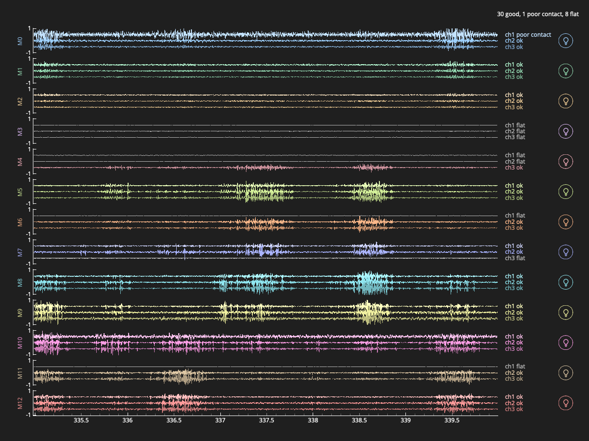

# CleverHand-python

> **Fork notice:** this repository, [**CleverHand-python**](https://github.com/simonavrillon/CleverHand-python),
> is **simonavrillon's fork** of the original
> [Aightech/CleverHand](https://github.com/Aightech/CleverHand). It is named after its
> defining change: the host stack is **reimplemented in pure Python** — the former
> C++ driver is replaced by the [`clvhd`](software/driver/CleverHand-interface)
> package. The fork is also heavily modified and cleaned up: the submodules
> (`CleverHand-hardware`, `CleverHand-interface`, `hc32l110_clvhd`) are absorbed as
> plain directories and `Cleverhand-configGUI` was removed. See
> [*This fork: pure-Python driver and 13-module EMG wristband*](#this-fork-pure-python-driver-and-13-module-emg-wristband)
> for the fork-specific implementation. For upstream issues, PRs and contribution
> rules (`CONTRIBUTING.md`), please use the original repository. All original
> license files are kept unchanged (`LICENSE`, `LICENSE-DOCS`, `LICENSE-HARDWARE`,
> and the `LICENSE` file in each former submodule directory).

**CleverHand** is an **open-source, modular hardware–software platform for Human–Machine Interfaces (HMI)**, designed to support high-quality biosignal acquisition and multimodal sensory feedback in **research, education, and advanced prototyping**.

The platform enables the acquisition of physiological signals (EMG, ECG, EEG, IMU, etc.) and the delivery of feedback (electrotactile, vibrotactile, visual), with a strong emphasis on **modularity, reproducibility, and data quality**.

CleverHand is not a closed product.
It is an **open infrastructure** intended to be:

* built and modified by researchers,
* integrated into experimental systems,
* and reused across multiple projects without redesigning the stack each time.

---

## Diagram

---

## Project philosophy

* **Open by design**
  All hardware, firmware, and software are open-source. Users may self-manufacture modules or assemble them via standard PCBA services.

* **Research-first, not consumer-first**
  CleverHand prioritises signal integrity, timing control, and experimental flexibility over plug-and-play simplicity.

* **Access without lock-in**
  For users who do not want to manufacture hardware themselves, pre-assembled and tested modules may be offered as an *access layer* (shop), without restricting openness.

* **Long-term maintainability**
  Stable interfaces, documented modules, and explicit quality-control practices are preferred over rapid feature churn.

---

## System overview

CleverHand devices are built by chaining small, specialised modules that share:

* a common electrical and communication interface,
* a unified firmware and data model,
* and a host-side software stack (GUI, LSL, Python, C++).

---

## Repository structure

* [`hardware`](hardware/CleverHand-hardware/README.md)
  Hardware design files (KiCad), manufacturing data, and module-level documentation.
* [`software`](software/)
  * [`driver`](software/driver)
    Python driver (`clvhd`), examples, and the Teensy controller firmware.
  * [`firmware`](software/firmware/)
    Embedded firmware for inter-module communication and host interfacing.

---

## Key features

### Modular architecture

* 1 to 32 modules per device
* Sensor, feedback, communication, and interface modules can be freely combined

### Position-based addressing

* Module addresses are inferred from physical position in the chain
* No hardcoded IDs or manual configuration

### High-quality biosignal acquisition

* Up to **4 kHz sampling rate**
* **24-bit resolution** (ADS1293 / ADS1298 based modules)
* Designed for EMG and other low-amplitude physiological signals

### High-density wearable design

* Typical module size: **20 × 20 mm**
* Integrated gold-plated electrode pads (e.g. 3 × 18 mm)
* Supports dense spatial sampling

### Flexible connectivity

* Wired: USB, Ethernet
* Wireless: Bluetooth, Wi-Fi (others possible depending on controller)

### Unified software interface

* Real-time visualisation
* Pure-Python API (`clvhd`) — this fork; the upstream C++ API and configuration GUI are not part of it

---

## Background and motivation

Details

### Motivation

Electromyography (EMG) provides a non-invasive way to measure muscle activation and is widely used in:

* human–machine interaction,
* prosthetics and assistive devices,
* rehabilitation and exoskeleton control,
* sports science and biomechanics.

Despite its importance, existing EMG systems often fall into two extremes:

* **low-cost, low-performance** wearable devices,
* or **high-performance, high-cost** laboratory systems with limited portability.

### Limitations of existing systems

#### Wearable EMG devices

| Device               | Price   | Electrodes | Sampling rate | Resolution | Notes                         |
| -------------------- | ------- | ---------- | ------------- | ---------- | ----------------------------- |
| Myo armband          | ~200 $  | 8 bipolar  | 200 Hz        | 8-bit      | Easy to use, discontinued     |
| MyoWare              | ~40 $   | 3 bipolar  | 200 Hz        | 10-bit     | Suitable for prototyping only |
| Delsys Trigno Avanti | ~2000 $ | 16 bipolar | 2000 Hz       | 16-bit     | High quality, expensive       |

#### Non-wearable EMG systems

| Device              | Price  | Channels | Sampling rate | Resolution |
| ------------------- | ------ | -------- | ------------- | ---------- |
| OT Sessanta Quattro | ~10 k$ | 64       | 2000 Hz       | 24-bit     |
| OT Muovi+           | ~25 k$ | 4×32     | 2000 Hz       | 24-bit     |
| OT Quattrocento     | ~50 k$ | 382      | 2000 Hz       | 24-bit     |

### CleverHand approach

CleverHand aims to **bridge the gap** between these categories by providing:

* modular, wearable, high-density EMG acquisition,
* research-grade signal quality,
* and a system that scales from small experiments to complex multi-site recordings.

Each EMG module integrates an ADS1293 or ADS1298 AFE, supporting **3–8 channels per module**, sampled at **4 kHz / 24-bit**. Multiple modules can be chained to increase spatial coverage.

Gold-plated electrode pads on the PCB can be used directly or adapted via interface boards (flex electrodes, snap connectors, jack connectors).

---

## Additional capabilities

| Feature         | Description                       |
| --------------- | --------------------------------- |
| Visual feedback | RGB LEDs per module               |
| IMU             | Optional inertial sensing modules |
| Electrotactile  | Optional stimulation modules      |
| Vibrotactile    | Optional actuator modules         |
| Attachments     | Bracelet, mesh, custom mounts     |
| Interfaces      | GUI, LSL, Python, C++             |

---

## Project status & contributions

CleverHand is an **active research platform**.
Interfaces and core architecture are stabilising, while individual modules continue to evolve.

Contributions are welcome in the form of:

* issues and bug reports,
* hardware or firmware improvements,
* documentation and experiments,
* or external use cases and feedback.

If you plan to use CleverHand in a study or project, citations and references are appreciated.

---

## This fork: pure-Python driver and 13-module EMG wristband

This fork **reimplements the CleverHand host stack in pure Python** and implements a
**13-module EMG wristband** on top of the CleverHand platform:
each module is a **COM_MOD + EMG_DAQ_ADS1293 + DRY_ELEC_6CH_THIN**, chained on a
**Teensy 4.0** controller (S_TEENSY4 shield).

* **Host driver** — [`software/driver/CleverHand-interface`](software/driver/CleverHand-interface):
  the pure-Python `clvhd` package (replaces the former C++ driver) with streaming,
  `python -m clvhd.check` diagnostics, and examples, plus the Teensy controller
  firmware v4.1 under `firmware/uctrl_teensy`.
* **Node firmware** — [`software/firmware/hc32l110_clvhd`](software/firmware/hc32l110_clvhd):
  COM_MOD firmware with I2C bounds-checks, an addressing-race fix, and dimmed LEDs
  to stay within the Teensy 3.3 V budget.
* **Hardware** — [`hardware/CleverHand-hardware`](hardware/CleverHand-hardware):
  trimmed to the boards used by the 13-module wristband.

*Live plot (`examples/01_live_plot.py`) of a 13-module band during repeated contractions:
20–450 Hz band-pass and 50 Hz notch, ±1 mV per module. Each module has its own colour;
flat channels (shorted electrode pairs) are grayed out, and each channel's contact
status sits next to its trace. The round buttons light up a module's LEDs.*

Status: tested on a physical 13-module band (the stream is complete at 8 MHz SPI), and
the driver is also checked against a simulated Teensy.

