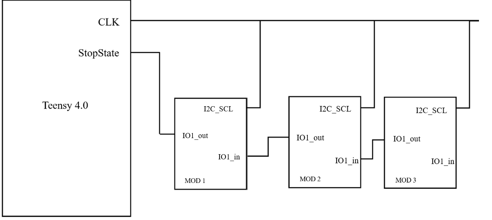
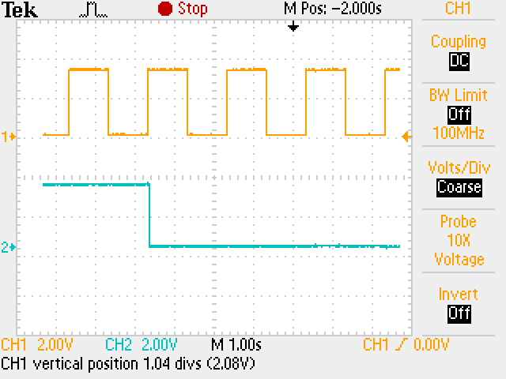
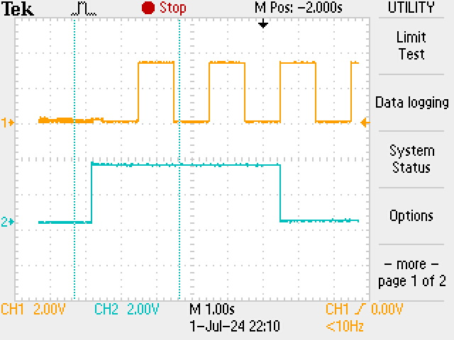

# Module addressing

At power-up no COM_MOD has an address. The Teensy gives each module a unique address from its position in the chain (1 for the module next to the Teensy, then 2, 3, ...), then the modules switch to I2C for their LEDs.

The address drives a 74HC688 comparator on each node: when the Teensy puts the same 5-bit value on the address bus (Teensy pins 2-6), the comparator pulls the ADS1293's CSB low. Address 16 is never used, so the bus idles there, and the chain holds at most 15 modules.

## Signals

| Signal | Teensy | COM_MOD | Role |
|---|---|---|---|
| CLK | pin 19 (I2C SCL) | P36 (I2C_SCL, pin 20) | addressing clock, shared by all modules; I2C SCL afterwards |
| STOP | pin 8 → module 1 | in: P31 (net `IO1_out`, pin 15); out: P02 (net `IO1_in`, pin 3) → next module | chain from module to module: low once the previous module has its address |
| AVAIL | pin 18 (I2C SDA), pull-up | P35 (I2C_SDA) | shared; held low by every module without an address; I2C SDA afterwards |
| ADD0-4 | — | P34, P33, P32, P03, P15 | the module's address, to its 74HC688 |

The net names follow the bus: `IO1_out` is the previous module's output, which this module reads.

## Sequence

The Teensy (`ClvHd::initModules()` in `uctrl_teensy/clvHd_util.hpp`) holds its STOP output low, then sends 1 us clock pulses 1 ms apart while AVAIL is low (at most 32). On each rising edge, every module without an address (`PORT3_IRQHandler()` in `User/main.c`):

- if its STOP input is high (the previous module has no address yet), counts the edge;
- otherwise takes the count as its address, releases AVAIL, and 100 us later pulls its STOP output low. The delay makes sure the next module, which handles the same edge in its own interrupt, still reads STOP high on this edge.

So module *k* takes address *k* on the *k*-th edge, and AVAIL goes high once every module has an address. The number of pulses is the number of modules.

| Edge | Module 1 | Module 2 | Module 3 | AVAIL |
|---|---|---|---|---|
| — | STOP in low (Teensy) | STOP in high | STOP in high | low |
| 1 | address 1, STOP out low | count 2 | count 2 | low |
| 2 | — | address 2, STOP out low | count 3 | low |
| 3 | — | — | address 3, STOP out low | high: the Teensy stops |

On the next clock edge, which the Teensy drives once AVAIL is high and leaves high (the I2C idle level) before `Wire.begin()`, each module sees AVAIL high, disables the clock interrupt and starts an I2C slave at its address. The Teensy then sets the LEDs over I2C (`'i'` command, see the driver's `docs/serial_protocol.md`).

The Teensy reports the result of the addressing (`'s'` command):

- **stuck** if AVAIL is still low after 32 pulses: a module never saw its STOP input go low (broken `IO1` line). The STOP input has a pull-up, so a broken line stops the chain there instead of giving two modules the same address.
- **too many** if more than 15 modules took an address.

Addressing runs once per power-up: after a Teensy reset (e.g. a firmware upload) the modules keep their addresses and the new firmware finds none, so power-cycle the whole wristband.

## LEDs

The LEDs are dimmed (`LED_ON`, 16/255): at full brightness 13 nodes overload the Teensy's 3.3 V supply. While the clock runs, the LED refresh is skipped, as writing the LEDs disables the interrupts for ~30 us.

| LED1 | LED2 | State |
|---|---|---|
| red | off | powered, waiting for the clock |
| yellow | off | counting edges (module 1 never counts: it stays red) |
| yellow (red on module 1) | magenta | has its address |
| yellow (green on module 1) | white | every module has its address: I2C running |

The driver turns the LEDs off once the modules are addressed.

## Measurements

These scope captures come from an early version of the protocol, with a much slower clock.

Module 1. Ch1: CLK. Ch2: STOP from the Teensy (`IO1_out`). Ch3: STOP from module 1 to module 2 (`IO1_in`).

Module 2. Ch1: CLK. Ch2: comparator output (CSB), low when the address bus matches the module's address (00010).

Module 3, as above (address 00011).
